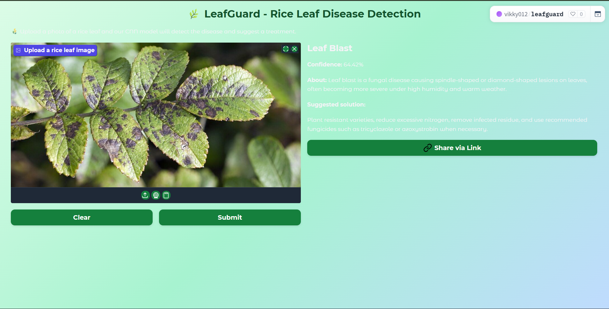
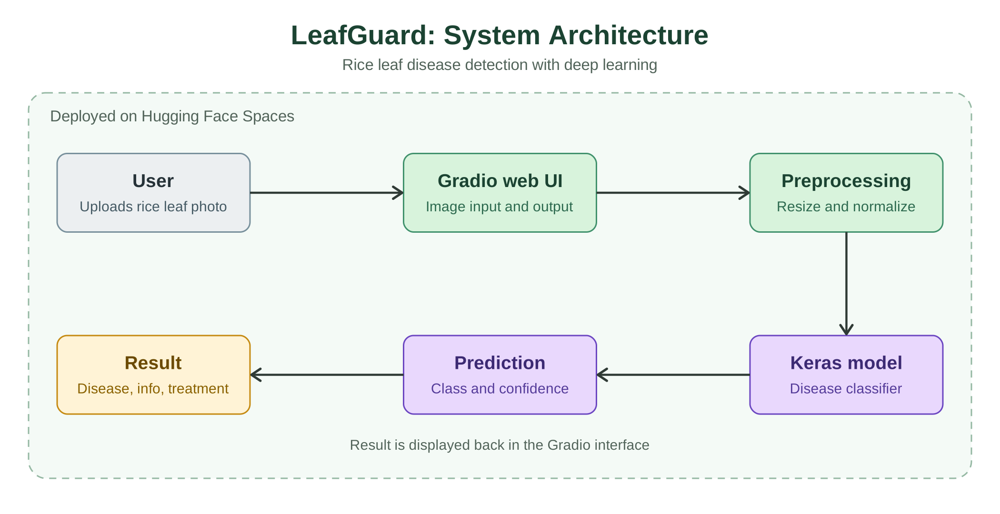

# LeafGuard: Rice Leaf Disease Detection

LeafGuard is a deep learning web app that identifies diseases in rice leaves from a single photo. Upload a clear picture of a leaf and the app returns the disease name, a confidence score, a short description, and suggested treatment steps, so farmers can act early and protect their crop.

**Live demo:** https://vikky012-leafguard.hf.space



## How it works

1. The user uploads a photo of a rice leaf.
2. The image is resized and normalized.
3. A trained Keras model classifies the disease.
4. The app shows the predicted disease, confidence, description, and treatment advice.

## Architecture



## Tech stack

- Python
- TensorFlow / Keras (model: `models/rice_leaf_disease_model.keras`)
- Gradio (web interface)
- Hugging Face Spaces (hosting)

## Run it on your computer

```bash
git clone https://github.com/kvikasreddy/leafgaurd-.git
cd leafgaurd-
pip install -r requirements.txt
python app.py
```

Then open the local address printed in the terminal (usually http://127.0.0.1:7860).

The model file is stored with Git LFS. If the model does not download, install Git LFS (https://git-lfs.com) and run `git lfs pull`.

## Project structure

```
app.py                  Gradio app
models/                 Trained Keras model
assets/                 Architecture diagram and screenshots
requirements.txt        Python dependencies
```

## Author

K Vikas Reddy
